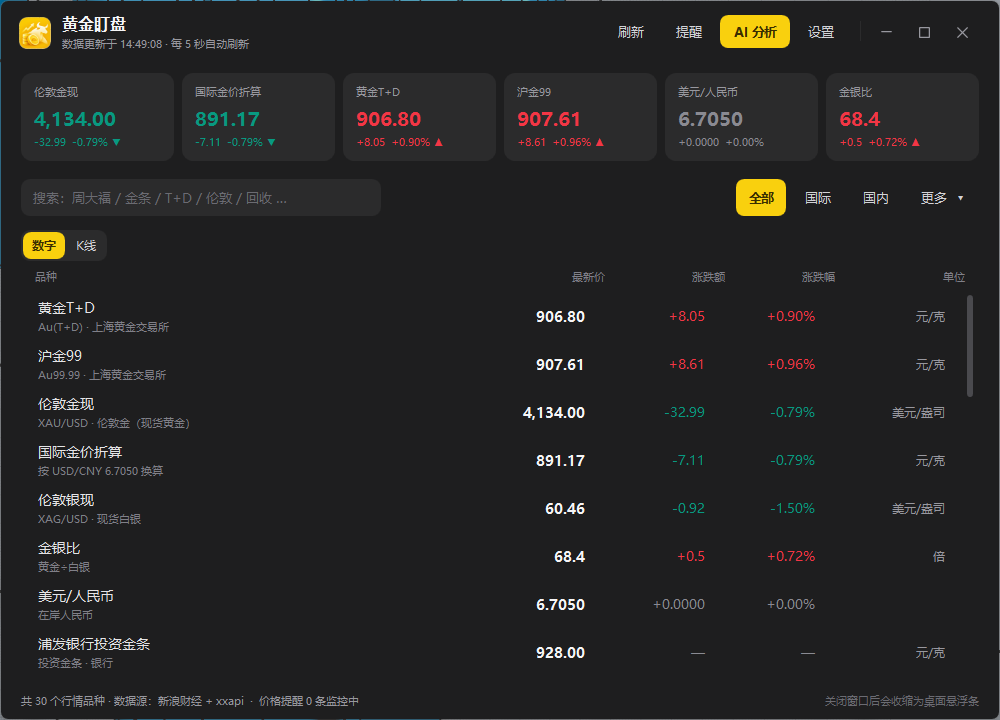
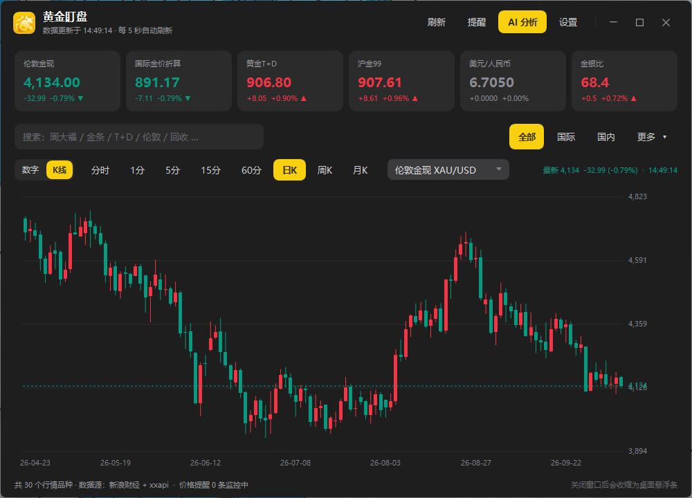
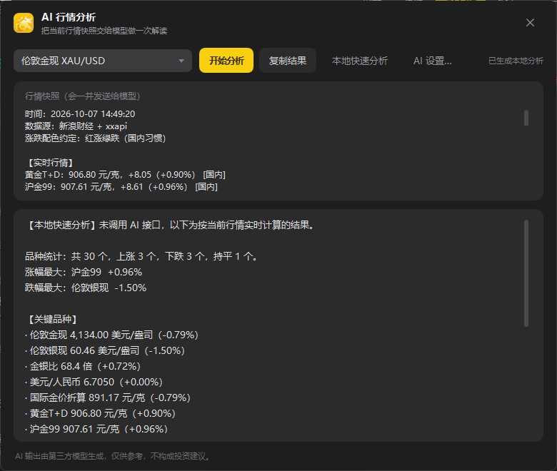
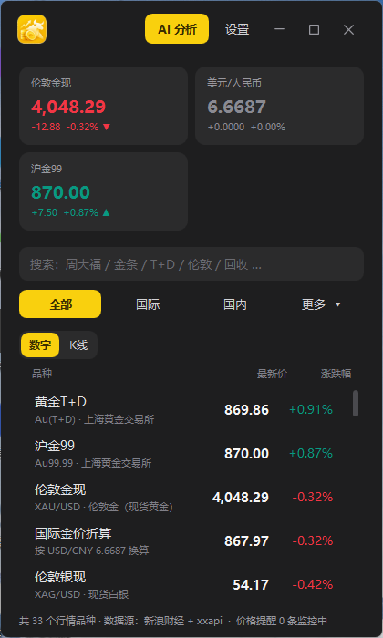

# 黄金盯盘 GoldWatch

一款 Windows 桌面黄金行情小工具：实时跟踪 **伦敦金现（XAU/USD）**、**国内金价（Au(T+D)、沪金 99）**、**银行投资金条**、**品牌足金首饰价** 与 **黄金回收价**，支持 K 线、桌面悬浮条、价格提醒与 AI 行情解读。

程序基于系统自带的 **PowerShell + WPF** 运行，安装包约 2.5 MB，**不需要额外安装 .NET 或任何运行库**。



## 功能

- **行情总览**：33 个品种，覆盖国际现货、上金所、银行金条、品牌首饰、回收价与汇率折算
- **K 线图**：分时 / 1 分 / 5 分 / 15 分 / 60 分 / 日 / 周 / 月，支持滚轮缩放
- **桌面悬浮条**：常驻桌面、可调透明度与缩放，点关闭按钮自动收起
- **价格提醒**：上穿 / 下穿目标价弹窗 + 声音提示，支持批量管理
- **表头排序**：点「品种 / 最新价 / 涨跌额 / 涨跌幅」排序，带 ▲▼ 指示
- **概览卡片可编辑**：长按卡片进入编辑，可增减卡片、调整宽高
- **窄窗自适应**：窗口最窄 380px，可收成长条形态，列表自动收起次要列
- **AI 分析**：接入任意 OpenAI 兼容接口（默认 DeepSeek），一键生成行情解读
- **在线更新**：内置更新源，启动自动检查，一键下载安装并自动重启新版本





## 下载与安装

从 [Releases](../../releases) 下载最新的 `黄金盯盘_vX.Y.Z.exe`，双击按向导安装即可。

- 安装位置可自选，可勾选是否创建桌面快捷方式
- 卸载：「开始」菜单 →「卸载 黄金盯盘」，或 Windows「设置 → 应用」
- 用户数据保存在 `%APPDATA%\GoldWatch`，卸载时默认保留

**系统要求**：Windows 10 / 11（Windows 7 SP1 需已安装 PowerShell 5.1）

> 安装包未做代码签名，首次运行可能出现 SmartScreen 蓝色提示，点「更多信息 → 仍要运行」即可。

## 在线更新

客户端内置固定更新源，用户无需任何配置：

```
主源   https://cdn.jsdelivr.net/gh/<owner>/goldwatch@main/update.json
备源   https://gh-proxy.com/https://raw.githubusercontent.com/<owner>/goldwatch/main/update.json
备源   https://raw.githubusercontent.com/<owner>/goldwatch/main/update.json
```

> 国内网络直连 `raw.githubusercontent.com` 通常超时，所以主源走 jsDelivr CDN，另外两个地址仅作兜底；客户端会按顺序重试并给出每个源的具体错误。

`update.json` 结构：

```json
{
  "version": "2.3.2",
  "download_url": "https://gh-proxy.com/https://raw.githubusercontent.com/<owner>/goldwatch/main/release/GoldWatch_Setup_v2.3.2.exe",
  "download_mirrors": [
    "https://raw.githubusercontent.com/<owner>/goldwatch/main/release/GoldWatch_Setup_v2.3.2.exe"
  ],
  "release_notes": "本次更新内容，客户端弹窗里按行显示",
  "mandatory": false,
  "size": 2592739,
  "sha256": "安装包的 SHA256"
}
```

> **为什么安装包不走 jsDelivr**：jsDelivr 对 `.exe` 一律返回 403（实测 README 和 JSON 正常），
> 所以 `update.json` 走 jsDelivr，安装包走 `gh-proxy` + `raw` 多源重试；
> 客户端会按 `download_url` → `download_mirrors` 的顺序逐个尝试，全部失败才报错。

发布新版本只需三步：

1. 改版本号 → 重新编译安装包
2. 把新安装包放进 `release/`，同步更新 `update.json` 的 `version` / `download_url` / `size` / `sha256`
3. 提交推送即可，客户端下次检查就能升级

`mandatory: true` 时会隐藏「稍后提醒」，强制用户更新。

## 目录结构

```
.
├── README.md
├── update.json              # 更新源（客户端读取）
├── release/                 # 各版本安装包
└── screenshots/             # 界面截图
```

## 数据来源

- 新浪财经（伦敦金银、上金所、汇率）
- Gold-API（国际现货备用源）
- open.er-api.com（汇率兜底）
- xxapi 聚合（银行金条 / 品牌首饰 / 回收价）

## 免责声明

本软件仅用于行情浏览与提醒。所有数据来自第三方公开接口，可能存在延迟或误差，**不构成任何投资建议**。请以交易所与银行的官方报价为准。
